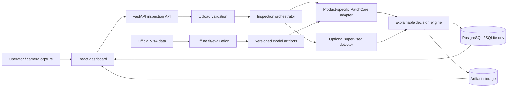

# BoardLens architecture

BoardLens is a modular monolith for an industrial proof of concept. It deliberately keeps training jobs outside the request-serving process and stores large image/model artifacts on disk rather than in the relational database.

The serving boundary accepts only validated JPEG, PNG, or WebP uploads, enforces encoded and decoded size limits, selects a product-specific model, persists the exact threshold version, and emits `PASS`, `FAIL`, or `REVIEW` with reasons. Missing models produce `REVIEW`; they never produce invented scores.

PatchCore models remain product-specific because PCB layouts are spatially structured and VisA PCB1–PCB4 are distinct products. A shared model is not assumed valid without a separate controlled experiment.

## Deployment topology

Development uses SQLite and local artifact directories. Docker Compose uses PostgreSQL plus separate backend/frontend containers and persistent artifact/model volumes. The frontend never reads model files directly.

## Trust boundaries

- Upload filenames are ignored; UUID-derived paths prevent traversal.
- Image bytes are decoded and verified before inference.
- Model artifacts are loaded only from configured local paths.
- SQL access uses SQLAlchemy parameters.
- Runtime errors return stable error bodies without internal paths.

