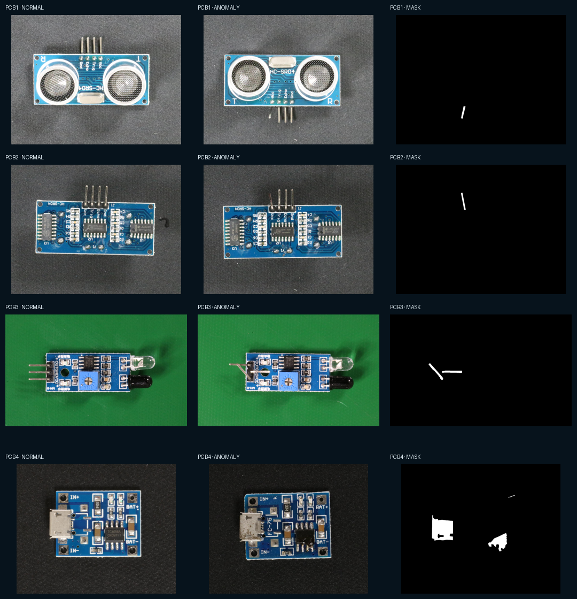

# VisA dataset audit

## Provenance and license

- Official project: `wxs56837/visa_dataset`, accompanying the ECCV 2022 SPot-the-Difference work.
- Official object storage archive: `VisA_20220922.tar`.
- Server-reported archive size verified on 2026-10-09: **1,929,840,640 bytes**.
- Dataset license: **CC BY 4.0**. Attribution and the upstream license must accompany redistributed derivatives.

The official documentation reports 10,821 total images: 9,621 normal and 1,200 anomalous. PCB subsets report:

- PCB1: 1,004 normal, 100 anomalous, 4 anomaly classes.
- PCB2: 1,001 normal, 100 anomalous, 4 anomaly classes.
- PCB3: 1,006 normal, 100 anomalous, 4 anomaly classes.
- PCB4: 1,005 normal, 100 anomalous, 7 anomaly classes.

The local validator completed successfully across all 4,416 PCB images and 400 anomaly masks. Every referenced image and mask exists and decodes successfully. All images are RGB. PCB1/PCB2 are 1404×1070, PCB3 is 1562×960, and PCB4 is 1358×1104. The generated audit at `artifacts/results/dataset-audit.json` also records per-category annotation hashes and all observed semantic mask IDs.

## Split policy

BoardLens uses the upstream `split_csv/1cls.csv` through the official `utils/prepare_data.py`. It does not reshuffle the published train/test membership. Because that split provides no defective validation set, this proof-of-concept threshold experiment divides the official test portion by sorted even/odd index: 50 normal + 50 anomalous images calibrate PCB1, and the remaining 50 + 50 are held out from calibration. Therefore, only the odd half is used for the thresholded result, and neither half should be reused as an untouched official-test claim. A release-quality protocol must introduce a separately governed validation set or cross-validation without leaking the final benchmark test set.

The locally generated official-split manifests contain:

- PCB1: 904 train-normal, 100 test-normal, 100 test-anomaly.
- PCB2: 901 train-normal, 100 test-normal, 100 test-anomaly.
- PCB3: 905 train-normal, 101 test-normal, 100 test-anomaly.
- PCB4: 904 train-normal, 101 test-normal, 100 test-anomaly.

## Annotation semantics

Original anomalous images have pixel masks; normal masks are omitted. The observed original IDs match the upstream mappings: background plus 1–4 for PCB1–PCB3 and 1–7 for PCB4. Annotation rows can contain multiple comma-separated defect labels, so one image is not necessarily one class. The official preparation utility converts these multi-class masks to binary 0/255 masks in MVTec layout. Binary masks support anomaly localization evaluation. They must not be presented as semantic defect labels. A supervised semantic detector still needs component-level validity and class-frequency/split analysis; BoardLens does not infer boxes/classes that are not present.

## Validation performed by tooling

`python -m ml.datasets.validate_visa data/raw/VisA` checks every annotated image can be decoded, records dimensions/modes, checks referenced masks, counts label strings, and hashes each category annotation CSV.

